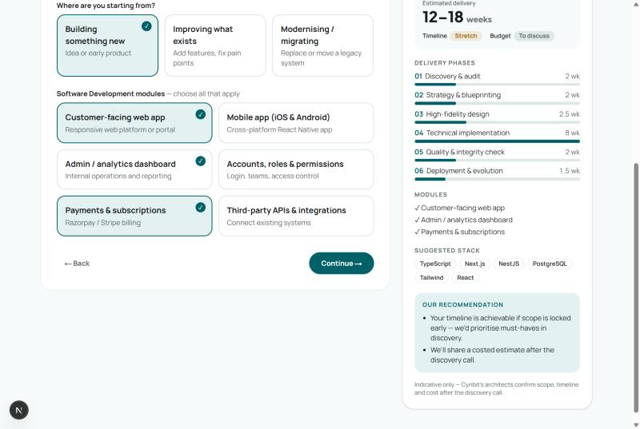

# Cynbit Project Blueprint Builder

A working prototype that replaces the static "Start discovery" inquiry forms on [cynbit.in](https://www.cynbit.in) with a guided scoping wizard. Visitors get an **instant indicative blueprint**: phases on Cynbit's six-stage lifecycle, a timeline, a stack, and a budget/timeline fit check. Cynbit gets a **structured, priority-scored lead**.

> Unofficial prototype built for the Cynbit Technologies Full Stack Developer Intern task. Not affiliated with or operated by Cynbit.

- **Live demo:** _&lt;deployed URL&gt;_ (try `/?service=cloud` for a deep link)
- **Technical report:** [docs/TECHNICAL_REPORT.md](docs/TECHNICAL_REPORT.md)



## Features
- Four-step wizard (Service → Scope → Constraints → Contact) with a live blueprint panel
- Honest fit check for timeline and budget, with MVP-first recommendations
- Deep links per service (`?service=ai-automation|software|cloud|marketing`)
- Server-side validation (Zod), recomputed blueprint and lead score, rate limiting, honeypot
- Printable / save-as-PDF blueprint on the confirmation page
- `/admin` sales inbox ranked hot / warm / cold behind a bearer token
- Accessible: real radio/checkbox inputs, fieldsets, live region, inline errors, focus management

## Stack
Next.js 15 (App Router) · React 19 · TypeScript · Tailwind CSS v4 · Zod · Vitest

## Run locally
```bash
npm install
cp .env.example .env.local   # set ADMIN_TOKEN to a long random string
npm run dev                  # http://localhost:3000 — admin at /admin
npm test                     # 23 unit + API tests
```

## Environment
| Variable | Purpose |
|---|---|
| `ADMIN_TOKEN` | Required for `GET /api/inquiries` and `/admin` |
| `WEBHOOK_URL` | Optional: forwards each lead as JSON (CRM, Slack, Zapier) |
| `DATA_DIR` | Optional: location of `leads.jsonl` (defaults to `.data/`, or the OS temp dir on Vercel) |

## Deploy (Vercel)
Import the repo in Vercel, set `ADMIN_TOKEN` (and optionally `WEBHOOK_URL`), and deploy. No other configuration is needed. File storage on serverless hosts is ephemeral, so use `WEBHOOK_URL` or swap `src/lib/store.ts` for a database in production.

## Project layout
```
src/lib/catalog.ts        services, modules, effort ranges, lifecycle
src/lib/blueprint.ts      estimation engine (shared by client and server)
src/lib/lead.ts           lead scoring
src/lib/schema.ts         Zod request schemas
src/lib/store.ts          JSONL store + webhook
src/app/api/inquiries/    POST submit, GET admin list
src/components/           BlueprintWizard, BlueprintPreview
src/app/admin/            sales inbox
```
