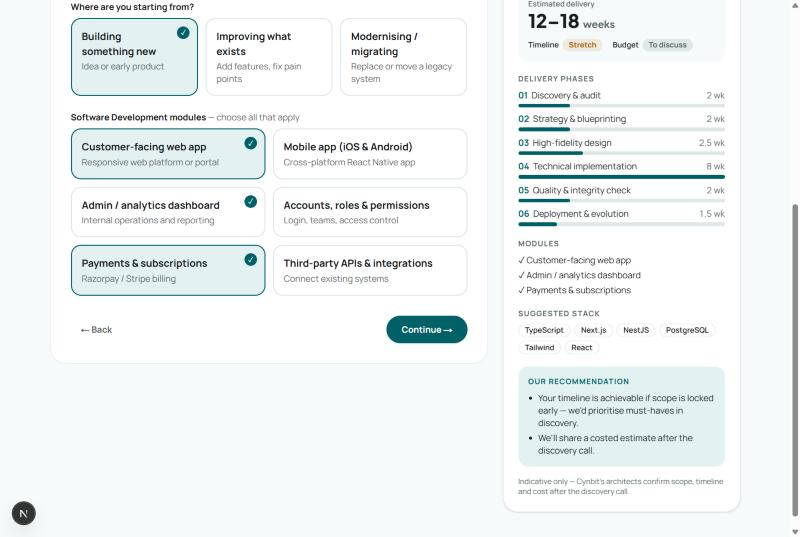
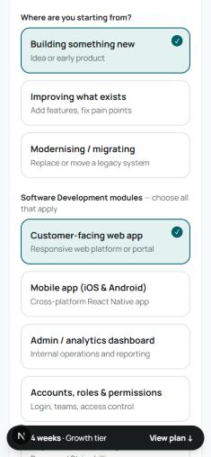

# Technical Report — Project Blueprint Builder for cynbit.in

**Author:** Maloth Bhavsingh · **Role applied for:** Full Stack Developer Intern · **Date:** 31 October 2026
**Live prototype:** _&lt;deployed URL&gt;_ · **Repository:** https://github.com/Ramssmb/cynbit-website-improvement

---

## 1. Summary

I replaced Cynbit's static "Start discovery" inquiry forms with a **Project Blueprint Builder**. It is a four-step scoping wizard that shows visitors an **instant, indicative project plan** while they answer. The plan covers delivery phases mapped onto Cynbit's own six-stage lifecycle, a timeline estimate, a suggested stack, and a budget/timeline fit check. Visitors then send it to Cynbit as a **structured, server-validated, priority-scored lead**.

It improves two things at once:

- **For visitors (conversion, UX):** they get value *before* handing over an email, not 24 hours later.
- **For Cynbit's team (operations):** every inquiry arrives pre-scoped with service, modules, scale, timeline and budget, ranked hot/warm/cold, instead of as a free-text message.

## 2. Analysis of the current site

I reviewed cynbit.in as a visitor and as a developer on 31 Oct 2026, using browser inspection and the performance APIs.

### What works well
- A modern stack: Next.js App Router, self-hosted fonts and code-split chunks. About 45 requests and roughly 344 KB transferred on the home page; one sample loaded in about 1.75 s. Performance is not the bottleneck.
- All 12 home-page images have `alt` text. There is one `<h1>` per page, and titles and meta are descriptive.
- Strong, consistent brand: teal `#006067`, Manrope and Plus Jakarta Sans.

### The problem: the main conversion step gives nothing back
Every primary call to action ("Start discovery", "Start discovery phase", "Inquire") ends at a static form:

| Entry point | Form | What it captures |
|---|---|---|
| `/contact` ("Start discovery" on the home page) | Inline form | Name, email, company, **free-text** industry, message |
| `/services` → "Inquire" | Modal per service line | Name, email, company size, service dropdown, brief |

Issues observed:

1. **No scoping.** Neither form asks about scope, scale, timeline or budget, which are the four facts a sales architect needs to qualify a lead. They have to come out of a free-text message or an extra call.
2. **No value before commitment.** The contact page promises: *"Our team will analyze your requirements and prepare a tailored strategic overview before we connect."* The visitor sees nothing until a reply that may take up to 24 hours. A high-intent visitor comparing agencies gets no reason to stay.
3. **Blank-page problem.** "Your message" is a required empty textarea. Non-technical founders, a large share of an agency's audience, often don't know what to write, so they leave.
4. **Inconsistent data.** Two forms with different fields, one of them free-text, make it hard to route, report on or prioritise inquiries.

### Why this improvement over others
I considered a performance pass, an AI chatbot, and a portfolio filter. Performance is already acceptable. A chatbot adds cost and unpredictability and does not produce structured data. The inquiry flow is where the site's revenue happens, and it is the one place where a better experience also gives the business better data. It also showcases the work Cynbit sells: automation, lead qualification, and clear blueprints.

## 3. The solution

**Flow:** Service → Scope (stage + modules) → Constraints (scale, launch window, budget) → Contact → Confirmation with reference ID and a printable blueprint.

Key behaviours:

- **Live blueprint panel.** It recomputes on every choice: delivery weeks, tier, six lifecycle phases with proportional bars, modules, suggested stack, and plain-language recommendations. On phones a sticky bar keeps the estimate in view.
- **Honest fit check.** Timeline and budget are each rated *Aligned*, *Stretch*, *At risk* or *To discuss*. When a scope is too big, the tool recommends an MVP phase instead of a sales pitch.
- **Deep links.** `/?service=cloud` opens the wizard at step 2 with the service already chosen, so each "Inquire" button can link straight to its service.
- **Sensible defaults.** Stage, scale, timeline and budget are pre-selected ("Not sure yet" for budget), so the shortest path is about 4 clicks plus name and email.
- **Save as PDF.** The confirmation page has a print stylesheet, so visitors can forward the blueprint internally. That spreads Cynbit's brand within the buyer's company.
- **Sales inbox (`/admin`).** Behind a bearer token, leads are listed by score with the reasons behind it.

### Screenshots
| Desktop — live preview | Mobile — sticky estimate |
|---|---|
|  |  |

## 4. Technical stack and why

| Choice | Reason |
|---|---|
| **Next.js 15 (App Router) + React 19 + TypeScript** | Same framework as cynbit.in, so the feature could be dropped into their codebase as a route and a component with no new infrastructure. API routes give a backend with no separate server. |
| **Tailwind CSS v4** | Fast to match Cynbit's tokens. Colours and fonts are CSS variables in `globals.css`, so re-theming is one file. |
| **Zod** | One schema for parsing, validating and typing the API body. It also returns field-level messages that the UI shows inline. |
| **Pure TypeScript engine shared by client and server** | `buildBlueprint()` runs in the browser for instant feedback and again on the server, so a tampered client cannot fake a blueprint or lead score. |
| **Vitest** | Fast, ESM-native, and needs no config beyond a path alias. |
| **Vercel** | Zero-config Next.js hosting and the platform Cynbit's own stack implies. |

No database was added on purpose (see §7). Storage is behind a two-function interface (`saveLead`, `listLeads`), so it can be replaced with Postgres or Supabase without touching the API or UI.

## 5. Architecture

```
Browser                                         Server (Next.js route handler)
┌───────────────────────────────┐   POST JSON   ┌────────────────────────────────────┐
│ BlueprintWizard (client)      │ ────────────► │ /api/inquiries                     │
│  ├ state: scope + contact     │               │  1. rate limit (5 / 10 min / IP)   │
│  ├ buildBlueprint() ─ live ─┐ │               │  2. zod: inquirySchema (+honeypot) │
│  └ BlueprintPreview ◄───────┘ │ ◄──────────── │  3. buildBlueprint()  ← recomputed │
└───────────────────────────────┘  201 {id, bp} │  4. scoreLead()                    │
                                                │  5. saveLead() → JSONL (+webhook)  │
/admin ── GET + Bearer ADMIN_TOKEN ───────────► │  GET: timing-safe token check      │
                                                └────────────────────────────────────┘
```

| File | Responsibility |
|---|---|
| `src/lib/catalog.ts` | Services, modules and effort ranges, mirroring cynbit.in/services, plus Cynbit's lifecycle stages |
| `src/lib/blueprint.ts` | Estimation engine: weeks, tier, phases, fit checks, recommendations |
| `src/lib/lead.ts` | 0–100 lead score → hot / warm / cold, with reasons |
| `src/lib/schema.ts` | Zod schemas, including a check that modules belong to the chosen service |
| `src/lib/store.ts` | JSONL lead store and optional `WEBHOOK_URL` forwarding |
| `src/lib/rate-limit.ts` | Fixed-window, in-memory limiter |
| `src/app/api/inquiries/route.ts` | POST (submit) and GET (admin list) |
| `src/components/BlueprintWizard.tsx` | Steps, deep link, accessible choice cards, form, success state |
| `src/components/BlueprintPreview.tsx` | Live blueprint rendering, also used on the confirmation page |
| `src/app/admin/page.tsx` | Sales inbox |

## 6. Implementation details

**Estimation model.** Each module has an indicative effort range in weeks. Modules built by one team overlap, so the largest module counts in full and each extra one adds 70% of its range. Then a scale factor is applied (MVP ×0.75, Growth ×1, Enterprise ×1.4), plus ×1.15 for migrations and a fixed 2 weeks for discovery, QA and launch. The total is split across Cynbit's six lifecycle stages by fixed shares (implementation 45%, design 15%, and so on). Tiers are ≤8 weeks Starter, ≤16 Growth, and above that Enterprise. Every number lives in `catalog.ts` with a comment saying it is a placeholder for Cynbit to calibrate.

**Fit checks.** Timeline fit compares the estimate with the chosen launch window: *aligned* if the max fits, *stretch* if only the min fits, *risk* otherwise. Budget fit compares the tier with the largest tier each budget band covers.

**Lead score.** Points come from budget band, urgency, tier, budget-scope alignment, a named company, and a detailed brief. The score is clamped to 0–100: ≥60 is hot, ≥35 warm, otherwise cold. Reasons are stored with the score so sales can see *why* a lead ranks where it does.

**Security and robustness**
- The server recomputes blueprint and score; client-sent values are never trusted.
- Zod rejects unknown enum values, modules from another service, oversized fields and a filled honeypot.
- Per-IP rate limiting returns 429 with `Retry-After`.
- The admin token is compared with `crypto.timingSafeEqual`. It is sent in an `Authorization` header, never in the URL.
- A webhook failure is logged but never fails the visitor's submission.

**Accessibility.** Choice cards are real `<input type=radio|checkbox>` elements inside `<fieldset>`/`<legend>`, visually hidden but keyboard-reachable, with a visible focus ring. Field errors use `aria-invalid` and `aria-describedby`. The preview is an `aria-live="polite"` region. Focus moves to each step's heading on navigation, and the progress bar marks `aria-current="step"`.

**A bug found during browser testing.** Clicking "Continue" on step 3 submitted the contact form immediately. React reused the same DOM `<button>` and changed its `type` to `submit` during the click, so the browser treated the click as a submit. The fix is to give the two buttons distinct `key`s so React mounts a new element. There is a comment in the code explaining it.

## 7. Results

| Check | Result |
|---|---|
| Unit and API tests (`npm test`) | **23 passing**: engine, fit logic, scoring, schema, POST/GET, validation, rate limit, auth |
| Type-check / lint / production build | Clean |
| Home route first-load JS | **113 kB** (102 kB is the shared Next.js runtime) |
| End-to-end in the browser | Deep link → modules → constraints → invalid email (inline server error) → valid submit → reference ID → lead visible via admin API, scored *hot / 70* |
| Mobile (375 px) | No horizontal overflow; sticky estimate bar |

### How I would measure impact on the real site
Run an A/B test of `/contact` against the Blueprint Builder for 4–6 weeks and track:
1. **Inquiry completion rate:** form views → submissions. This is the primary metric.
2. **Lead quality:** share of leads that book a discovery call and the share sales rate as qualified.
3. **Time to first response:** with scope already captured, replies can include a tailored note instead of a questionnaire.
4. **Drop-off by step:** add analytics events per step to find where visitors leave.

## 8. Limitations and next steps

- **Storage is ephemeral on serverless.** On Vercel the JSONL file lives in the instance's `/tmp`, so the deployed admin inbox is a demo. For production: set `WEBHOOK_URL` (CRM, Slack, Zapier) and/or replace `store.ts` with Postgres or Supabase. Both already appear in Cynbit's listed stack.
- **The rate limiter is per instance.** Move it to Redis or Upstash when running more than one instance.
- **Estimates are illustrative.** The effort ranges, tier thresholds and budget bands are placeholders. Cynbit's architects should calibrate them from past projects. The UI states this on every blueprint.
- **Ideas for later:** email the blueprint PDF to the visitor; add a calendar booking step after submit; send GA4 events per step; offer an optional AI summary of the free-text brief for the sales team; add Hindi localisation.

## 9. Running it

```bash
npm install
cp .env.example .env.local   # set ADMIN_TOKEN
npm run dev                  # http://localhost:3000, admin at /admin
npm test
```

_This is an unofficial prototype built for the internship task. It is not affiliated with or operated by Cynbit Technologies, and the site says so in a banner._
